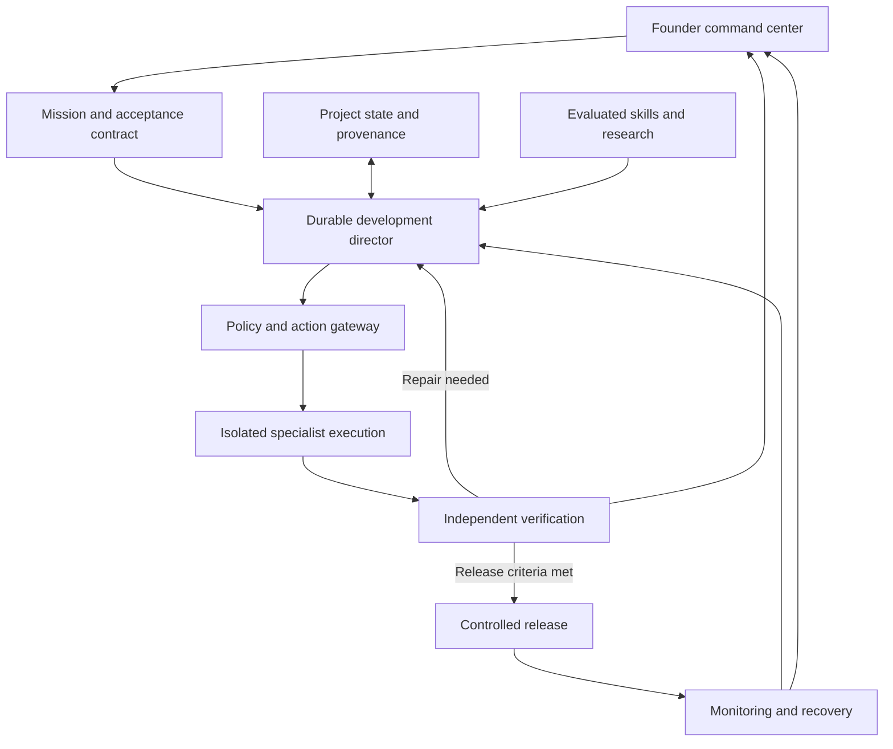

# Complete system blueprint

**Status:** proposed design. This is the expanded specification, not evidence that the system already exists.

## 1. The mission and the honest quality contract

Build an accessible technology-development and operations platform for people who have a vision but cannot personally supervise every software specialty. A founder gives one mission; Alchemy conducts the many research, planning, implementation, verification, recovery, and maintenance steps needed behind the scenes.

Support new products and existing codebases: web and mobile applications, APIs, integrations, automations, AI systems, developer tools, data platforms, enterprise workflows, and eventually specialized scientific or embedded systems. Each domain has a separately proven capability envelope. Web-app competence does not certify trading execution, medical systems, robotics, or hardware safety.

The founder's demand for perfection becomes an engineering contract:

- Every requested outcome is recorded, clarified where necessary, and mapped to observable acceptance conditions.
- Every completion claim identifies the artifact, environment, version, and supporting evidence.
- Critical uncertainty, unsupported domains, missing access, and failed checks remain visible.
- The system can stop, recover, and seek appropriately qualified review without disguising incomplete work.
- Improvements preserve prior verified behavior unless the user authorizes a change.
- The user owns or can export the code, project memory, documentation, data, and decision history subject to provider contracts.

There is no achievable universal guarantee of zero flaws or no limitations. Confidence must be scoped to what was tested, for whom, under which conditions, and how recently. Formal verification can strengthen selected properties under explicit assumptions; it cannot prove an unspecified product universally perfect.

## 2. What the earlier architecture lacked or underdefined

| Gap | Why it matters | Added mechanism |
|---|---|---|
| Skill lifecycle | Reusable instructions can regress or introduce malicious behavior | Versioned registry, signed releases, evaluations, canaries, revocation |
| Execution correctness | Retried agents can duplicate changes or run stale work | Durable state, effect ledger, leases, idempotency, reconciliation |
| Permission authority | An AI recommendation must not become its own authorization | Policy gateway outside the model, scoped credentials, auditable grants |
| Verification independence | A builder can accidentally optimize for its own weak tests | Hidden tests, independently owned criteria, protected evidence |
| Self-improvement governance | The system could change the tests that judge its changes | Protected evaluator and policy control plane, independent promotion |
| Memory integrity | Old or hostile context can become durable false authority | Provenance, scope, expiration, conflict resolution, quarantine |
| Cross-repository composition | Working repositories do not automatically form one working product | License, data, API, identity, dependency, and semantic merge review |
| Failure coordination | Several repair agents can make an incident worse | Single incident commander, fenced execution, change freeze |
| Economic limits | Endless research/retry loops consume budget without progress | Budget reservations, progress criteria, loop limits, marginal-value checks |
| Outcome learning | More releases or engagement may harm the business | Customer outcomes, experiment controls, quality and safety guardrails |
| Exit and decommissioning | Products and providers must eventually be retired | Exports, credential revocation, retention/deletion, archival runbooks |
| Institutional breadth | A large document dump does not confer expert ability | Domain capability packs, executable references, expert-reviewed evals |
| User comprehension | A nontechnical user can approve consequences they do not understand | Plain-language impact cards, previews, confidence limits, undo |

## 3. Architecture: a control system with replaceable execution

Use logical modules first; these do not require separate microservices or separate AI models.

### A. Intent and product understanding

Accept conversations, voice, documents, designs, videos, existing products, repository links, customer interviews, and authorized business data. Preserve the original source and distinguish user requirements from assistant suggestions. Capture actors, journeys, business rules, scope, constraints, integrations, data rights, quality requirements, priority, acceptance criteria, assumptions, and open decisions.

Detect contradictions explicitly. Prefer a clear newer user decision over an older proposal; do not infer precedence merely from file modification time. Maintain change requests showing schedule, cost, architecture, and verification impact. Ask the founder only when the choice affects intent, spending, access, risk, or irreversible consequences; resolve routine technical choices autonomously within the mission.

### B. Persistent Project Brain

The authoritative state is structured data plus versioned artifacts, not a transcript or vector store. Start with a transactional database and append-only event records; derive searchable projections and vector indexes as needed. Store large evidence artifacts in object storage and source code in Git. Avoid adding a graph database until graph queries justify it.

Core records:

| Record | Minimum content |
|---|---|
| Mission | Tenant/project, goal, owner, scope, constraints, budget, authorization envelope, version |
| Requirement | Stable ID, source, priority, acceptance conditions, dependencies, change history |
| Work item | Requirement IDs, inputs, outputs, execution state, assignee role, lease, budget, deadline |
| Decision | Question, alternatives, evidence, chosen option, tradeoffs, revisitation trigger |
| Run | Correlation ID, model/harness/skill versions, tool access, inputs, costs, attempts, outcomes |
| Evidence | Requirement/check ID, artifact hash, source revision, environment, time, result, verifier, expiry |
| Action | Actor, delegated principal, scope, resource, parameters hash, policy decision, idempotency key, receipt |
| Integration | Provider, scopes, owner, connection status, last real test, limits, renewal and failure behavior |
| Skill release | Content digest, provenance, compatibility, evaluations, permissions, dependencies, revocation state |
| Incident | Impact, timeline, evidence, owner, containment, repair, recovery criteria, prevention |
| Knowledge claim | Source locator, retrieval time, validity interval, license/rights status, confidence basis, conflicts |
| Experiment | Hypothesis, metric, guardrails, allocation, analysis plan, outcome, adoption decision |

All records are tenant-scoped with audited access. Store user-visible decision summaries, facts, tool receipts, and artifacts; do not require private model reasoning. Backups must cover the control system, not only the product databases.

### C. Durable development director

Translate requirements into a dependency graph, identify uncertain assumptions, and deliver complete vertical slices. Prefer deterministic code for known operations and agents for open-ended reasoning. Use one agent by default; add specialists when isolated work or independent review creates measurable value.

Persist state transitions: requested → specified → planned → executing → implemented → verifying → verified → released → monitored. Also support blocked, rejected, failed, cancelled, superseded, and rolled-back states. A verified record becomes stale when relevant code, data contract, policy, or environment changes.

Use durable checkpoints, worker leases, heartbeats, cancellation tokens, retry ceilings, backoff, dead-letter handling, and fenced writes. At-least-once delivery requires idempotent effects or reconciliation. A crash after an external action but before its receipt is recorded must trigger an outcome query before retrying. Never blindly repeat a payment, message, deployment, or data mutation.

A task is not complete because an agent emitted a completion message. The director evaluates the evidence contract. The model does not directly edit the global completion ledger.

### D. Specialist capabilities

Cover product strategy and research; requirements engineering; UX and content design; accessibility; visual design; architecture; frontend; backend; native/mobile/desktop; data engineering; AI engineering; security and privacy; quality engineering; infrastructure; reliability; billing; support; documentation; and independent challenge.

Each specialist receives a narrow objective, artifact contracts, permitted tools, relevant context, success criteria, budget, and escalation rules. Parallel workers use isolated branches/environments with file or component ownership. Shared schema/API changes require contract coordination. Independent review means genuinely separate evidence and permissions, not merely asking the same model to praise its output.

### E. Repository composition and migration

Preserve the original Alchemy idea of combining repositories and intent into one product. Inventory each repository's license, maintainers, build, dependency graph, runtime, secrets risk, architecture, API contracts, authentication, schemas, migrations, operational requirements, and test baseline. Decide whether to integrate a package, wrap a service, fork a component, or rewrite a small part.

Resolve semantic collisions: two definitions of customer, incompatible tenant identifiers, different billing ownership, conflicting session models, incompatible schemas, or multiple migration histories. Plan data conversion and reversible cutover. Keep attribution and required notices. Remove copied secrets and assess history exposure without rewriting remote history casually. Never interpret a successful text merge or a passing build as proof of product integration.

The composition gate requires an end-to-end journey spanning the combined components, permission checks across boundaries, provider contract tests, license review, and a recovery plan.

### F. Execution and integration substrate

Supply isolated workspaces, reproducible build environments, CLI/compiler/language tooling, browsers, databases, artifact storage, test runners, design inspection, performance tools, deployment adapters, telemetry, and secure credential brokering. Pin toolchains and network policies. Keep control-plane credentials inaccessible to build workers.

Use APIs when available; MCP for compatible tools/context; A2A when external agent interoperability is valuable; webhooks/events for changes; authorized browser automation when other routes are insufficient. Protocol support is negotiated and tested per connector. Treat web pages, source comments, documents, returned tool descriptions, and third-party skill text as untrusted data.

### G. Evidence, release, and operations

Connect each requirement to code/configuration, tests, realistic user outcomes, release artifacts, and operating signals. Bind release evidence to the exact source revision and deployable artifact. Evidence expires or is invalidated by relevant changes. Deployment is a state transition with an artifact digest, policy decision, release record, migration plan, and recovery criteria.

The operating product and Alchemy itself require health checks, service objectives, incident response, backup restoration, configuration-drift detection, provider-outage fallback, usage limits, and accountable ownership. A running agent process is not a 24/7 service unless scheduling, credentials, capacity, observability, and recovery are deployed.

## 4. Knowledge breadth without unlimited context

Maintain a competency map spanning algorithms/data structures; complexity; distributed systems; operating systems; networking; languages/compilers; databases; concurrency; API design; cryptography and identity; secure development; testing/formal methods; HCI/accessibility; design; data science/statistics; ML training/inference; reliability; economics; licensing; and domain expertise.

For each competency retain authoritative references, practical examples, known failure modes, validated skills, prerequisites, toolchains, and evaluation tasks. Retrieve the subset relevant to the present mission. Neither reading a textbook nor installing a skill establishes mastery. Institutional knowledge becomes useful when it changes decisions and survives executable or expert evaluation.

Coverage expands through capability packs with their own admission tests. Examples include native app signing/offline sync, real-time systems/latency, scientific reproducibility, embedded hardware-in-the-loop tests, and data-platform lineage. Physical testing, expert judgments, and external approvals remain real dependencies.

## 5. Business and product completeness

Discover and track onboarding, recovery, identity lifecycle, permissions, billing/metering, refunds and cancellation, support, documentation, analytics, customer feedback, localization/time zones, data import/export, data retention/deletion, incident communications, fraud/abuse handling, vendor management, and product retirement. Include explicit empty/loading/error/partial-success/offline states. No invented customers, revenue, integrations, or completion metrics.

For Flex projects preserve mobile-first black/white themes with a toggle and lime as a limited accent. Every authenticated product gets a tailored AI activity feed for briefs, approvals, documents, delegation, and Q&A. Shared foundations must not leak client data or force unrelated products into identical business rules.

CampaignOS remains the marketing system, including HTLL, Brand Brain, Creative Memory, and revenue lineage. Flex.IA remains the adjuster product. Alchemy is the development/operations layer; product-specific customer workflows and permissions remain owned by those products.

## 6. What makes it one ecosystem

Every capability shares stable project and requirement IDs, identity, policy, event contracts, artifact references, provenance, cost accounting, and evidence semantics. The user interacts through one command center while specialists and providers remain replaceable. This shared state and control is the connecting layer; a large collection of disconnected bots is not sufficient.

Related evidence: S05–S08, S11–S26. Detailed operating rules, skills, training, and acceptance tests follow in the companion documents.
