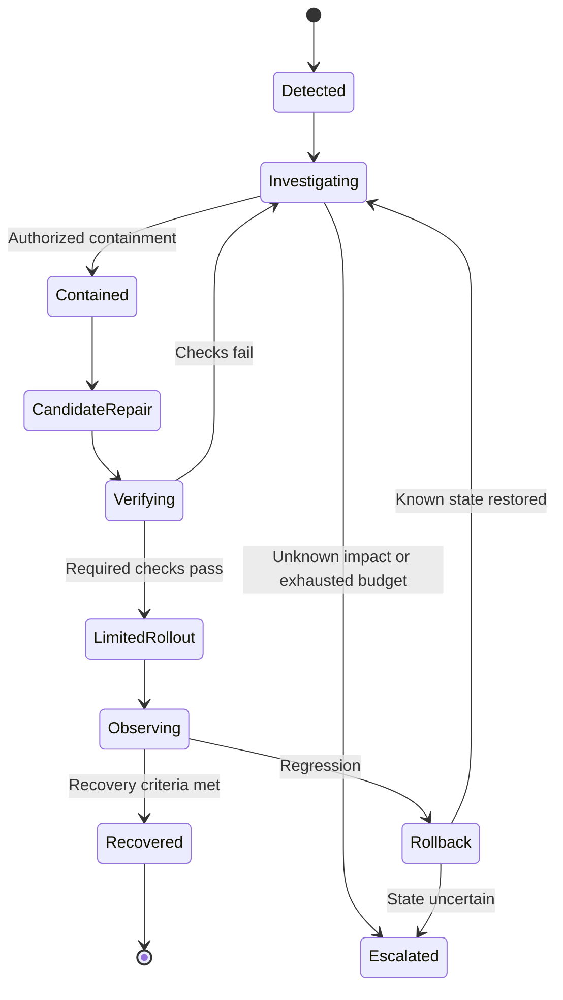

# Autonomous operations, security, and improvement loops

**Status:** proposed operating model. These loops are not running yet.

## 1. The correct model for autonomy

The requested healing, analysis, debugging, security, research, coding, and growth loops are necessary capabilities, but they are not a complete system alone. They need shared state, priorities, permissions, evidence, resource limits, and an authority to resolve conflicting actions.

Use one common contract: observe → establish context → diagnose or propose → check authority → act within scope → independently verify → observe outcomes → retain the learning. Distinguish diagnosis, containment, repair, and prevention. Restoring availability does not necessarily fix the underlying bug.

Do not make endless loops the default. Every loop has a trigger, owner, state, deadline, attempt budget, cost ceiling, stop rule, and escalation destination. An improvement that increases cost or uncertainty without measurable benefit is not progress.

## 2. Explicit operating envelopes

| Mode | Autonomous behavior | Boundary |
|---|---|---|
| Observe | Read authorized telemetry, inspect code, research, report | No external state change |
| Prepare | Reproduce, create branches, run isolated tests, draft repairs | No production effects |
| Bounded operate | Execute allowlisted runbooks and releases within standing grants | Resource, time, cost, and impact limits enforced |
| Supervised change | Prepare consequential change with evidence and preview | Concrete decision by authorized person |
| Restricted domain | Collect evidence and assist a qualified specialist | No claim of independent competence outside validated scope |

Standing authorization is specific: actor, action class, resources, environment, maximum impact/spend, validity period, and required evidence. Reuse it instead of repeatedly asking the same question. Check it at dispatch and immediately before consequential effects. Revocation and stale evidence must stop queued work too.

Destructive data operations, changed permissions, new external commitments, uncontrolled spending, and changes to the control plane need stronger rules than a reversible UI fix. The exact rules are configured with the owner, not invented by an agent during execution.

## 3. Loop inventory

| Loop | Trigger and work | Completion evidence | Stop or escalation rule |
|---|---|---|---|
| Analysis | Requirement change, telemetry anomaly, customer feedback; construct causal hypotheses | Discriminating evidence, uncertainty, recommendation | No information gain or missing access |
| Debugging | Reproducible defect; minimize case, isolate layer, compare alternatives | Original failure reproduced, fix passes, adjacent regressions checked | Attempt/time cap or inconsistent reproduction |
| Healing | Service degradation; contain, apply known runbook or evaluated repair | Service recovery plus user journey and data-integrity checks | Worsening impact, rollback failure, uncertain data state |
| Security leadership | Advisory, suspicious behavior, exposure, access change | Finding disposition, tested remediation, access audit | Suspected compromise or high-impact policy change |
| Research | Knowledge expiry, technology change, unresolved decision | Current sources, conflicting evidence, actionable conclusion | Saturation, budget cap, no project relevance |
| Coding | Approved work item; implement a complete vertical slice | Artifact plus independent acceptance evidence | Repeated failure or blocked prerequisite |
| Product growth | Customer friction or business hypothesis | Experiment outcome including guardrail metrics | Harm, unclear attribution, insufficient sample |
| Cost/performance | Budget or latency regression | Same required quality at improved total cost/latency | Quality degradation or shifted costs |
| Skill improvement | Repeated procedure or failure pattern | Held-out uplift and compatibility results | Regression or unsafe behavior |
| Model improvement | Proven gap not solved by skills/tools/retrieval | Licensed dataset and candidate beats baseline | Data rights unclear, benchmark leakage, negative economics |
| Maintenance | Dependency, API, certificate, quota, or infrastructure drift | Compatible update and verified journeys | Breaking contract or unsupported migration |
| Retirement | Feature/provider/product no longer needed | Export, retention/deletion disposition, revocation, archive | Unresolved customer or data obligations |

All loops compete through the director's scheduler. During a material incident, reliability/security work takes precedence and unrelated changes can be frozen. Suppress duplicate alerts and coalesce related symptoms rather than spawning a new agent per log line.

## 4. Healing state machine

Gather deployment version, changes, metrics, traces, logs, queue depth, provider status, and customer impact. Redact secrets. Reproduce in isolation where practical. Compare competing hypotheses with the cheapest useful check. Prefer a previously validated bounded recovery action to a novel production edit.

Create the patch in an isolated branch. Run the regression that would have caught the incident, integration/permission checks, and failure-path tests. Stage a limited rollout where supported; use error rate, latency, data correctness, and real user success to decide promotion or rollback. Observation duration depends on traffic and failure characteristics; a quiet minute is not enough evidence for a low-traffic system.

Some effects cannot be rolled back. Emails already sent, trades executed, and deleted records without valid recovery points need reconciliation or compensating actions. Database changes use compatibility-aware migrations; reverting application code can be unsafe if the schema or data changed incompatibly.

Keep one repair owner per incident/component and use fencing tokens to reject stale workers. If external infrastructure is unavailable, degrade functionality truthfully, preserve queued intent safely, and avoid a retry storm. PROBE illustrates why diagnosis and successful recovery must be measured separately (S28).

## 5. CSO/CISO capability

The requested CSO is best represented as a security leadership function supported by specialized agents and deterministic controls. It covers threat modeling, asset inventory, identity, credential lifecycle, secure design, dependency risks, incident readiness, security reviews, and risk reporting. It is not a claim that an AI holds accountable executive or legal responsibility.

Controls to implement:

- Separate tenant, user, service, and delegated-agent identities; least-privilege short-lived credentials.
- Tool authorization at the resource boundary, not only in a prompt. Validate resource ownership on every relevant read/write.
- Network restrictions, sandbox isolation, secret brokering, upload checks, and protected deployment credentials.
- Secret scanning, dependency scanning, static/dynamic analysis as appropriate, signed build provenance, component inventory, and pinned dependencies.
- Explicit trust boundaries around retrieved documents, code, tool descriptions, skill packages, memory writes, and agent-to-agent messages.
- Protection against goal hijacking, data exfiltration, memory poisoning, tool abuse, privilege escalation, supply-chain compromise, and runaway actions.
- Audited retention/deletion, encryption and key rotation, recovery access, incident evidence preservation, and notification ownership.

Use OWASP and NIST as coverage references (S22–S23), with a product-specific threat model. Scan findings need reproducible triage; a scanner's green badge is not a security guarantee. Legal/compliance requirements are established for the actual jurisdiction, data, and customers with qualified review when needed.

## 6. Protect the system that judges the system

The implementation worker cannot modify mandatory acceptance criteria, its held-out evaluator, permission policy, or signed evidence to make a failing task pass. Changes to those controls are separately reviewed and versioned. A test correction must explain the defect in the test and preserve the user's actual requirement.

Store evaluation results through an authenticated verifier service; protect artifact digests and policy decisions. Retain adversarial cases such as a builder deleting tests, fabricating logs, reclassifying a failed requirement as optional, or claiming a mocked provider is connected.

Monitor the monitor: an external watchdog checks worker health, event backlog, stale grants, budget enforcement, and evidence pipeline health. On control-plane uncertainty, pause consequential changes and preserve state. Security controls themselves need tested emergency access and recovery.

## 7. Growth and learning without goal drift

Keep three separate loops:

1. **Product value:** user success, retention, task completion, customer feedback, revenue when appropriate.
2. **Engineering quality:** fewer defects, faster recovery, maintainability, lower cost per verified outcome.
3. **System learning:** better routing, skills, retrieval, and eventually trained behavior.

A growth experiment states its hypothesis, primary metric, guardrails, target population, allocation, sample/stopping rule, and attribution limitations before launch. Avoid false certainty from small samples, repeated peeking, or confounded before/after comparisons. Do not optimize engagement, revenue, or code throughput at the expense of user welfare, privacy, reliability, or the founder's goals.

In CampaignOS, use the market insight → offer → creative → campaign → lead → qualified opportunity → revenue lineage, retaining unknown attribution. Publishing content, outreach, and spending follow the customer's authorization envelope. Alchemy may improve the product implementing this workflow; it does not inherit unlimited permission to run the customer's marketing.

Verified fixes can produce regression tests, candidate skills, updated runbooks, or curated training examples. Failures are retained with their context. Never feed every generated artifact back into training indiscriminately.

## 8. Cost and operational discipline

Reserve budget before work; account for model calls, retries, sandboxes, research, storage, tool fees, egress, training, and human review. Cap per-run, per-project, and organization spend. Keep capacity for recovery rather than consuming the entire budget on implementation.

Use a lower-cost model for bounded tasks only when measured completion quality is adequate. Escalate difficult architecture, ambiguous failures, and high-impact review. A cheap model with many failed attempts can be more expensive per verified result. Runaway-loop detection must consider repeated tool calls, unchanged artifacts, recurring errors, and no new evidence.

Autonomy is earned per action class. A product may autonomously recover a known stalled worker while still requiring review for schema rewrites. No single global "fully autonomous" switch accurately captures that distinction.
