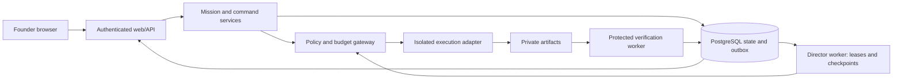

# Flex Alchemy — verified implementation baseline

Author: Codex, current chat model (no additional models invoked). Date: November 6, 2026, America/Chicago.

Status: repository inspection completed; architecture and implementation contracts below are PROPOSED. No application has been implemented, run, deployed, or security-certified by this baseline. No provider calls or paid model evaluations were made.

## 1. Authority and scope

The requested current specification is `README.md`, `MASTER_PROMPT.md`, `01-system-blueprint.md`, `02-skills-and-commands.md`, and `06-delivery-and-evaluation.md`, all under `docs/flex-alchemy/`. These were read before adding this document. They define the product, not proof of implemented behavior.

Additional inspection: root README, technology decisions (07), coordination review (10), standalone founder ruling (11), tracked tree, history, and relevant sections of the v3 union (12). The v3 architecture and provenance audit (13) were inspected for context, not exhaustively re-audited; neither the full Gemini source nor MASTER_PROMPT_V3 was adopted as a replacement specification.

Conflict register:

| Conflict | Baseline disposition |
|---|---|
| Doc 06 suggests CampaignOS/HTLL; doc 11 records a later standalone-SaaS ruling | Propose an Alchemy-owned pilot. No CampaignOS connection, inherited infrastructure, or invented HTLL rules. The worked example remains a future capability case. |
| Package index still identifies v2 while later v3 documents exist | Preserve existing documents; use the five requested files as the current implementation contract. Do not silently adopt every v3 tool or quantitative assertion. |
| Doc 10 recommends frontier models for hard work; current user requires approval before higher-complexity models | Current user instruction governs. No automatic escalation or extra agents. |
| Doc 10 proposes pushing everything and independent collaborator acceptance | This delivery is local documentation. No remote mutation is inferred from source text. Independent acceptance of future code remains pending; this inspection is not that review. |

## 2. Verified repository inventory

VERIFIED at inspection:

- Clone: `C:\Users\flexm\Documents\ChatGPT\Flex Alchemy\Flex-Alchemy`.
- Origin: `https://github.com/flexdinero/Flex-Alchemy.git`.
- Branch: `main`; HEAD and live `refs/heads/main`: `0319f181c940e0a55d51c95c956fc6ccd66714bb`.
- HEAD subject: “Zero-loss superset merge v3.0: union of Codex v2.0 package + Gemini Argon master blueprint + Cosmo review, under founder ruling doc 11”. Commit timestamp: `2026-11-04T03:23:56-06:00`.
- Five commits in inspected history; initial checkout clean. Eighteen tracked files, all Markdown. No tracked AGENTS.md, LICENSE, application source, package/lockfile, database migration, tests, CI, environment template, container definition, or deployment configuration.
- Parent workspace was an empty initialized Git repository with no commits/remotes. It was preserved; the requested repository was cloned into the child directory above. Run future Git commands inside the clone.

Full starting file inventory (paths relative to clone):

| File | Observed role |
|---|---|
| `README.md` | Original name/tagline |
| `docs/flex-alchemy/README.md` | v2 specification index |
| `docs/flex-alchemy/MASTER_PROMPT.md` | Requested execution contract |
| `docs/flex-alchemy/01-system-blueprint.md` | Control plane and system boundaries |
| `docs/flex-alchemy/02-skills-and-commands.md` | Skill lifecycle and command contracts |
| `docs/flex-alchemy/03-autonomous-operations.md` | Operational-loop specification |
| `docs/flex-alchemy/04-founder-experience.md` | Founder experience specification |
| `docs/flex-alchemy/05-knowledge-and-models.md` | Knowledge/model specification |
| `docs/flex-alchemy/06-delivery-and-evaluation.md` | B01–B15 backlog, E01–E20 evaluations |
| `docs/flex-alchemy/07-technology-decisions.md` | Provisional candidates and ADRs |
| `docs/flex-alchemy/08-research-sources.md` | Historical source register |
| `docs/flex-alchemy/09-coverage-matrix.md` | Requirement coverage claims |
| `docs/flex-alchemy/10-cosmo-verification-review.md` | Historical review and proposed coordination |
| `docs/flex-alchemy/11-founder-ruling-standalone-saas.md` | Standalone scope ruling |
| `docs/flex-alchemy/12-unified-superset-architecture.md` | Proposed v3 union |
| `docs/flex-alchemy/13-provenance-superset-audit.md` | Historical union audit |
| `docs/flex-alchemy/MASTER_PROMPT_V3.md` | Proposed merged prompt |
| `docs/flex-alchemy/sources/gemini-argon-master-blueprint-and-prompt.md` | Preserved source material |

Runtime inspection: Git `2.56.0.windows.4`, Node `v22.20.0`, npm `11.6.1`, pnpm `11.25.0`. Docker CLI exists but `docker version` cannot reach `dockerDesktopLinuxEngine`; no running database was established. `psql` was not found on PATH. These findings concern this shell, not every installed service or remote account. No dependencies installed. No build/test command exists to run. Clone/read access does not establish push permission, cloud account access, provider credits, or deployment rights. No exhaustive Git-history secret scan or dependency/license audit has been performed; absence of a tracked license requires an explicit licensing decision before distribution.

## 3. Proposed architecture

Use a TypeScript modular application, one web process, one durable worker process, PostgreSQL, and private artifact storage. Separate processes enforce different credentials; this does not require a microservice estate.



Boundaries:

- Web/API owns authenticated intent, validated contracts, feed and decision views. Browser input never supplies trusted identity or grants.
- Domain modules own state-machine transitions, policy decisions, budget reservations, command idempotency, and evidence eligibility. Models cannot directly update verification/release status.
- PostgreSQL owns business truth, events and work dispatch. Feed polling initially reads committed events; notifications are hints, not job truth. State change plus event/outbox insertion commit together.
- Worker claims a bounded job using a lease and monotonically increasing fence; every result write checks the current fence. It checkpoints before and after effects. Worker restart reconstructs state from the database.
- One execution adapter produces an immutable change artifact in a project sandbox. It cannot access application DB, identity credentials, verification secrets, or unrelated tenants.
- Protected verification consumes the exact artifact, requirements and independently controlled checks. Its receipt includes revision, digest, environment/configuration fingerprint, test-suite revision and results. Relevant changes invalidate evidence.
- Private artifact store records digest, size, media type, tenant/project and retention policy; authenticated download authorizes each access. A local filesystem implementation is valid for the private pilot only if it actually persists and applies access controls; shared/multi-host operation requires a real object-store adapter.

No graph/vector database, Redis, Kubernetes, proprietary training, perpetual agent teams, or multiple orchestration engines at the start. Preserve those requirements as later backlog items with admission gates. Evaluate one managed and one self-controlled harness on identical bounded tasks before selecting the first production execution path (doc 07); do not install both as runtime dependencies by default.

## 4. Dependency and procurement plan

All selections are proposals, not installed or account-verified integrations. Exact package versions must be resolved, compatibility-tested and locked in the first implementation PR; no guessed versions belong in a fabricated lockfile.

| Layer | Initial proposal | Adoption proof required |
|---|---|---|
| Runtime | Node 22 supported LTS line; update/pin a maintained patch before build | Match CI/container/toolchain and framework engines; installed 22.20.0 is not an approved security baseline |
| Package management | npm workspaces + one root package-lock.json | `npm ci` works on clean checkout; choose one manager despite pnpm availability |
| Interface/API | Next.js App Router, React, TypeScript strict mode | Production build, server-only imports, authenticated API, mobile journeys; no reliance on browser state for authority |
| Styling | CSS modules and explicit theme tokens initially | Black/white themes, limited lime, keyboard and contrast checks; no unnecessary UI dependency |
| Contracts | Zod | Reject unknown/invalid commands, size limits, typed JSON contracts |
| SQL | PostgreSQL 18 candidate, `pg`, `node-pg-migrate` | Real role/RLS/concurrency/migration and restore tests; provider supports selected major |
| Identity | Standards-based OIDC, `openid-client` | Actual issuer, PKCE/state/nonce, issuer/audience validation, secure sessions and logout; no home-built password system |
| Durable jobs | Transactional outbox + SQL leases | Kill/restart, duplicate delivery, stale fence and concurrent worker tests before adoption |
| Test tooling | Vitest, Playwright, axe-core integration | Real PostgreSQL integration and real browser journeys; no SQLite substitution for permission tests |
| Execution | One vendor-neutral harness contract, then selected real adapter | Account/scopes, isolation, cancellation, budget and receipt probe; no dummy “successful” implementation |
| Artifacts | Pilot local private store; managed object store when hosting chosen | Hash validation, cross-tenant denial, restart and restore; external SDK added only at that stage |
| Observability | Structured redacted logs and persistent action/event IDs | No secrets in logs; independent stale-worker and budget alarms before unattended operation |

Use existing platform identity, database, secret manager and storage services where they fit, but do not inherit another Flex product's account/configuration without explicit scope. Hosting/provider procurement, region, retention, support ownership and spending remain decisions. No paid resource is provisioned by this document.

Primary-source checks made November 6, 2026: [Next.js installation](https://nextjs.org/docs/app/getting-started/installation) documents App Router setup and Node minimum 20.9; a minimum is not a recommendation to use an EOL runtime. [Node releases](https://nodejs.org/en/about/previous-releases) identifies supported LTS lines. [PostgreSQL RLS](https://www.postgresql.org/docs/current/ddl-rowsecurity.html) documents default-deny, owner bypass and FORCE RLS. These checks validate specific technical premises, not the historical vendor claims throughout the blueprint. Package advisories, licenses, transitive dependencies and framework/provider compatibility still need a dated implementation-time audit.

## 5. First vertical slice and acceptance contract

Proposed Alchemy-owned mission: “Create a persistent mission register with source-backed requirements and a truthful activity feed; have Alchemy make one bounded improvement to this register and verify it.” This is a real SaaS capability and a real development task, rather than a separate marketing demo.

Implement in dependency order:

1. **Foundation (B02–B05):** actual OIDC login → create tenant/project → save mission and original intent → add stable requirement IDs and acceptance criteria → refresh/restart and retrieve unchanged state → display committed audit events. Require at least two test tenants and project membership enforcement. This is an implemented foundation only, not a verified agent director.
2. **Execution (B06–B07):** submit a versioned build command for one bounded change in an isolated pilot copy of the mission-register repository. Proposed change: add an optional mission due date with validation and persistent display. Preserve the initial revision and acceptance contract; reserve budget; execute with the single selected real harness; collect actual source diff and immutable artifact. Never let a worker modify the running control plane.
3. **Founder operation (B08–B09):** show real job states, costs, decisions, artifact and test evidence; pause/resume at safe checkpoints; export mission, requirement, event, decision and evidence records. Display genuine empty/error/blocked/loading states. Do not render unavailable tools as functional controls.
4. **Failure proof:** intentionally stop the worker mid-job; resume without duplicate command/effect. Inject a missing due-date persistence defect; protected verifier must reject the artifact. Repair and rerun against the new digest; retain the failed attempt. Simulated faults are explicitly labeled tests, never provider success claims.

Stable pilot requirement IDs:

| ID | Observable acceptance |
|---|---|
| FA-001 | Valid authenticated user creates/reads own mission after process restart; unauthorized tenant/project requests disclose no record |
| FA-002 | Original source and stable requirement IDs survive editing/versioning; changes retain author/time/provenance |
| FA-003 | Repeated command with same tenant/key/body returns same durable job; different body with same key conflicts |
| FA-004 | Revoked grant, unapproved stronger model, exhausted reservation and stale worker fence prevent dispatch/effect |
| FA-005 | Real harness creates bounded artifact in isolated workspace; unavailable access returns blocked, never fabricated output |
| FA-006 | Independent check catches planted persistence failure; builder cannot set verified or rewrite protected checks |
| FA-007 | Kill/restart, pause/resume and effect reconciliation preserve state and avoid duplicate effects |
| FA-008 | Mobile/desktop feed and evidence show actual state; export matches authorized persistent records and excludes secrets |
| FA-009 | Verification binds exact revision/digest/environment; modified input makes prior evidence stale |

No production deployment, billing, outbound messaging, external product integration, skill marketplace or proprietary training is part of this first slice. They remain explicit backlog scope. A running foundation does not satisfy FA-005–009. External credentials are a real dependency for completing the execution portion.

## 6. Environment contract

VERIFIED: no runtime variables are defined in the starting repository. The following names are proposed for future `config.ts` validation. Never populate tracked templates with live values. Required means required for the stated process/stage, not for reading this baseline.

| Variables | Consumer / requirement / handling |
|---|---|
| `NODE_ENV`, `ALCHEMY_PUBLIC_ORIGIN`, `PORT` | Web; validated deployment mode, exact trusted HTTPS origin and listener; local origin allowed only in development |
| `DATABASE_URL` | Web service; restricted runtime database principal; server secret |
| `MIGRATION_DATABASE_URL` | Migration job only; DDL role, never injected into web/worker |
| `DIRECTOR_DATABASE_URL` | Director only; queue/checkpoint/budget procedures, no identity-secret access |
| `VERIFIER_DATABASE_URL` | Protected verifier only; scoped evidence procedures, cannot change policy |
| `OIDC_ISSUER`, `OIDC_CLIENT_ID`, `OIDC_CLIENT_SECRET`, `OIDC_REDIRECT_URI` | Web identity; actual registered provider; secret only server-side |
| `SESSION_SECRET` | Web; generated high-entropy secret, rotation procedure; opaque server-side session records, secure HttpOnly SameSite cookies |
| `ARTIFACT_ROOT` | Pilot artifact service; absolute private persistent directory, outside public/static tree |
| `EXECUTION_ADAPTER`, `EXECUTION_SERVICE_URL`, `EXECUTION_SERVICE_TOKEN` | Director dispatch; only configured after actual adapter selected; short-lived scoped credentials preferred; absence blocks execution |
| `MODEL_PROVIDER`, `MODEL_ID`, `MODEL_API_KEY` | Inference broker only, if selected adapter uses direct inference; actual available provider/model; never forward unrestricted key to build sandbox |
| `PILOT_BUDGET_CURRENCY`, `PILOT_BUDGET_LIMIT_MINOR`, `MAX_RUN_SECONDS`, `MAX_ATTEMPTS` | Explicit numeric caps validated at startup; no unlimited defaults; authoritative per-tenant grants/reservations in DB |
| `LOG_LEVEL` | Service logging; redaction always enabled regardless of level |

Object-storage endpoint/bucket/region and credentials become required only when a provider is chosen; define those exact names in its ADR. Do not include irrelevant Vercel/Supabase/Stripe/email keys. No `NEXT_PUBLIC_*` secrets. Execution sandbox receives only short-lived capability-specific inputs, not this entire environment. Config fails closed for enabled features missing required values; a disabled integration is visibly unavailable and cannot return success.

## 7. Database and durability plan

Use SQL migrations and transactions. Proposed minimum schema groups:

| Group | Tables / purpose |
|---|---|
| Identity | `tenants`, `users`, `memberships`, `projects`, `project_memberships`, `sessions`; OIDC subject unique by issuer/subject; explicit tenant and project access |
| Intent | `missions`, `mission_versions`, `requirements`, `requirement_versions`, `decisions`; source locators/digests, acceptance revision and authorship |
| Work | `commands`, `work_items`, `runs`, `checkpoints`, `outbox_events`; idempotency, attempts, lease expiry, heartbeat, fence, correlation |
| Authority | `grants`, `budget_accounts`, `budget_reservations`, `usage_entries`, `actions`, `action_receipts`; actor/resource/parameter digest, expiry/revocation, reconciliation state |
| Evidence | `artifacts`, `verification_checks`, `evidence`, `exports`; hashes, revisions, actual verifier and immutable result metadata |

Migrations add tenant/project columns and compound foreign keys to prevent an object referencing a different scope. Enforce unique `(tenant_id, command_type, idempotency_key)` with request digest; optimistic version checks on mutable records; unique receipt/effect identifiers. Use integer minor currency units for reservations; retain original provider usage/price revision separately. Lock the budget account while checking available funds and inserting a reservation. Settle actual usage transactionally; reconcile missing usage instead of assuming zero. Reserve recovery capacity and cancel new spending when limits are reached.

RLS enabled and forced on scoped tables; runtime roles are neither owners nor superusers and lack BYPASSRLS, DDL and TRUNCATE. Separate migrator owns schema. Service derives actor identity from the verified session, sets transaction-local context and checks live membership. A caller-supplied tenant ID or SQL session variable alone is not proof of authority. Browser/workers receive no direct SQL access. Treat compromise of the trusted web role as a separate threat; restrict mutation procedures and privileges rather than claiming FORCE RLS makes a compromised service harmless. Privileged functions, if necessary, have fixed search paths, narrow EXECUTE grants and independent review.

Identity/membership revocation races require transactionally locked membership/grant checks at sensitive effects; queued approval is not permanent authorization. Dispatcher rechecks grant scope, expiry, revocation, artifact digest and spend immediately before use. External effects use stable idempotency tokens and an intent ledger; uncertain outcomes enter reconciliation and cannot be blindly retried. No exactly-once promise across network/DB boundaries.

Builder role cannot insert accepted evidence or set verified/released states. Verifier writes immutable checks; a deterministic transition procedure checks the complete current acceptance set. Append-only application events are not cryptographically tamper-proof against a database administrator; external audit retention is a later production control.

Initial migration sequence: `001_identity_and_projects` → `002_intent_versions` → `003_work_events_and_leases` → `004_grants_budget_and_actions` → `005_artifacts_and_evidence` → `006_roles_rls_and_transition_functions`. Keep runtime access disabled until security migration succeeds. Test clean creation and upgrade from each released schema. Prefer forward repair; irreversible data changes need backups and tested restoration, not an assumed down migration. Record RPO/RTO, retention and data region before production. Restore database and artifacts together and verify their digests/links.

## 8. Security boundaries and model economics

Threats to test: cross-tenant/project access; forged identity/approval/evidence; worker escape and secret theft; malicious repository/skill text; dependency scripts; artifact path traversal; SSRF/internal network access; stale leases; revoked grants; duplicate effects; spend races; evaluator tampering; poisoned memory; secret leakage through logs/exports.

Enforcement: authenticated server-side scope checks plus least-privilege SQL; CSRF/origin protection and secure sessions; input/size limits; Git URL and outbound network allowlists; no free-text shell interpolation; per-job filesystem/network/resource limits; private expiring artifact access; secret brokering; redacted logs; separate verifier credentials and immutable artifacts. Build containers alone do not prove hostile-code isolation: run the sandbox on separate infrastructure from the control plane and test the selected isolation mechanism before admitting untrusted code. No privileged container mounts, Docker socket, host home directory or cloud metadata access. Pause effects if authority, telemetry or state integrity is uncertain.

Model policy implements the user's current instruction:

1. Use deterministic code for inventory, formatting, hashes, schema checks and known state transitions: zero inference cost.
2. For bounded tasks requiring inference, use the absolute cheapest available configuration that passes that task's minimum acceptance checks. Record live account availability, dated prices, retries, verification cost and measured quality; “cheapest” cannot be truthfully named without those inputs.
3. No automatic stronger-model escalation. Persist a decision request with task, reason, exact model/configuration, estimated capped cost and scope. Wait for user approval before calling that model. Bind consent to this run/task and cap; no spend while waiting.
4. Missing access or insufficient quality means blocked/escalation-pending, not a silent fallback. No multi-model council by default. A checker process may be deterministic; model-based independent review requires a separate allowed configuration and the same spending controls.

This chat did not change its own host model or invoke additional models. The host session's model selection is not a capability of the proposed product routing policy.

## 9. Testing and evidence plan

No application tests have passed because there is no application yet. Proposed checks:

| Gate | Executable proof to build |
|---|---|
| Contracts/unit | Invalid states/commands rejected; status and currency arithmetic; digest/idempotency conflicts; expiry; no model completion text can grant verification |
| PostgreSQL integration | Real selected PostgreSQL major under actual web/director/verifier roles; allowed and denied reads/writes; forged context; cross-project compound-FK failures; missing membership; pooled-context reset; protected evidence and append-only events |
| Concurrency | Two command submissions, competing reservations, lease expiry/reclaim, stale fence result, revocation during dispatch; no double reservation/effect |
| Identity | Actual test issuer login/logout; invalid issuer/audience, expired session, CSRF and membership removal; test identity fixtures only in explicitly isolated tests |
| Execution/provider | Real adapter against an authorized pilot repository; missing key, outage, timeout, cancellation and unknown receipt; capture actual provider usage and deny unsupported fallback |
| Verification integrity | Planted persistence defect detected; builder attempts to edit checker/acceptance/evidence denied; changed artifact and environment invalidate prior evidence |
| Browser | Real API/DB-backed create/edit/refresh/feed/export; mobile and desktop; light/dark, keyboard, focus, screen-reader spot checks and automated accessibility; no fixture data presented as production |
| Failure/recovery | Kill processes, pause/revoke queued work, resume, duplicate event delivery, backup restoration, corrupt/missing artifact; compare restored state with expected durable records |
| Supply chain/security | Lockfile/advisory/license and secret scanning; malicious repository/skill inputs; sandbox egress, filesystem and resource escape attempts; redacted exports/logs |
| Economics/operations | Actual usage vs reservations, retry caps, stale-worker alert and controlled shutdown; no made-up SLO or throughput result |

Maintain all E01–E20 cases from doc 06 in the backlog. Initial slice exercises E02–E05, E08–E09, E12, E15–E19; skill/memory/release-specific cases remain deferred and must pass before those capabilities are admitted. A deterministic planted-defect check does not establish statistical model quality. Preserve the proposed 20-task / three-trial pilot as an evaluation design, not a result.

Each evidence record needs requirement/check ID, source and artifact digest, suite/config revision, environment, timestamps, verifier principal, raw log locator, exit status, omissions and freshness. Release gates include real integration, permission, recovery, accessibility and economics checks; passing unit/build checks alone is insufficient. Independent collaborator review of protected policy/evaluator changes remains required before acceptance; this baseline is not independent verification of itself.

## 10. Exact proposed files to begin building

Only this baseline document is added now. The following is a concrete creation plan, not a list of files already implemented. Each entry has a real responsibility; create it with working behavior in the relevant PR, never an empty facade. Paths are relative to clone.

**PR 1 — contracts, persistence and real identity (B02–B04):**

```text
.gitignore                              # exclude secrets, builds and local artifacts
.env.example                            # names/requirements only, no credentials
.node-version                           # tested exact runtime patch
package.json                            # npm workspaces and executable check scripts
package-lock.json                       # generated from actual resolved dependencies
tsconfig.base.json                      # strict shared compiler policy
eslint.config.mjs                       # actual lint rules
compose.yaml                            # pinned local PostgreSQL, health check, volume
.github/workflows/ci.yml                 # clean install, lint, types, DB tests, build
docs/flex-alchemy/implementation/requirements.md
docs/flex-alchemy/implementation/threat-model.md
docs/flex-alchemy/implementation/adr-001-stack-and-identity.md
apps/web/package.json
apps/web/tsconfig.json
apps/web/next-env.d.ts                   # generated by selected framework
apps/web/next.config.ts
apps/web/src/app/layout.tsx
apps/web/src/app/globals.css
apps/web/src/app/page.tsx                # authenticated mission list or login state
apps/web/src/app/loading.tsx
apps/web/src/app/error.tsx
apps/web/src/app/auth/login/route.ts
apps/web/src/app/auth/callback/route.ts
apps/web/src/app/auth/logout/route.ts
apps/web/src/app/api/projects/route.ts
apps/web/src/app/api/missions/route.ts
apps/web/src/app/api/missions/[missionId]/route.ts
apps/web/src/app/api/missions/[missionId]/requirements/route.ts
apps/web/src/app/api/projects/[projectId]/events/route.ts
apps/web/src/app/projects/[projectId]/page.tsx
apps/web/src/components/mission-form.tsx
apps/web/src/components/activity-feed.tsx
apps/web/src/components/theme-toggle.tsx
apps/web/src/server/config.ts
apps/web/src/server/auth.ts
apps/web/src/server/session.ts
apps/web/src/server/project-service.ts
apps/web/src/server/mission-service.ts
packages/contracts/package.json
packages/contracts/tsconfig.json
packages/contracts/src/commands.ts
packages/contracts/src/requirements.ts
packages/contracts/src/states.ts
packages/contracts/src/evidence.ts
packages/db/package.json
packages/db/tsconfig.json
packages/db/src/client.ts
packages/db/src/transaction.ts
packages/db/migrations/001_identity_and_projects.sql
packages/db/migrations/002_intent_versions.sql
packages/db/migrations/003_work_events_and_leases.sql
packages/db/migrations/004_grants_budget_and_actions.sql
packages/db/migrations/005_artifacts_and_evidence.sql
packages/db/migrations/006_roles_rls_and_transition_functions.sql
scripts/migrate.ts                      # actual node-pg-migrate SQL-file configuration
vitest.config.ts
tests/unit/contracts.test.ts
tests/integration/identity-and-tenancy.test.ts
tests/integration/mission-persistence.test.ts
```

**PR 2 — authority, director and real adapter (B05–B07):**

```text
packages/control/package.json
packages/control/tsconfig.json
packages/control/src/policy.ts
packages/control/src/budget.ts
packages/control/src/commands.ts
packages/control/src/transitions.ts
packages/control/src/actions.ts
packages/control/src/evidence-gate.ts
packages/execution/package.json
packages/execution/tsconfig.json
packages/execution/src/contract.ts
packages/execution/src/adapter.ts        # selected real provider; no success stub
packages/artifacts/package.json
packages/artifacts/tsconfig.json
packages/artifacts/src/store.ts         # real private persistence and digest validation
apps/director/package.json
apps/director/tsconfig.json
apps/director/src/config.ts
apps/director/src/main.ts
apps/director/src/dispatch.ts
apps/director/src/reconcile.ts
apps/verifier/package.json
apps/verifier/tsconfig.json
apps/verifier/src/config.ts
apps/verifier/src/main.ts
apps/verifier/src/verify.ts
docs/flex-alchemy/implementation/adr-002-execution-isolation.md
docs/flex-alchemy/implementation/provider-access-register.md
tests/integration/policy-and-budget.test.ts
tests/integration/leases-and-effects.test.ts
tests/integration/evidence-authority.test.ts
tests/integration/execution-isolation.test.ts
```

**PR 3 — complete founder journey, recovery and evidence (B08–B09):**

```text
apps/web/src/app/api/projects/[projectId]/commands/route.ts
apps/web/src/app/api/runs/[runId]/route.ts
apps/web/src/app/api/runs/[runId]/pause/route.ts
apps/web/src/app/api/runs/[runId]/resume/route.ts
apps/web/src/app/api/projects/[projectId]/export/route.ts
apps/web/src/app/api/artifacts/[artifactId]/route.ts
apps/web/src/app/api/decisions/[decisionId]/route.ts
apps/web/src/components/run-controls.tsx
apps/web/src/components/evidence-drawer.tsx
apps/web/src/components/decision-card.tsx
playwright.config.ts
tests/e2e/founder-journey.spec.ts
tests/e2e/accessibility.spec.ts
tests/recovery/interrupted-run.test.ts
tests/recovery/restore.test.ts
tests/acceptance/mission-due-date.test.ts  # independently protected acceptance check
scripts/backup.ts
scripts/restore.ts
scripts/export-evidence.ts
docs/flex-alchemy/implementation/runbook.md
docs/flex-alchemy/implementation/evidence/README.md
```

Protect verification/acceptance files through repository branch policy and isolated evaluator revisions before code execution starts. A path name is not an access control. Sandbox deployment configuration must be recorded in ADR-002 after the actual provider is selected; its provider-specific file names cannot be honestly fixed today.

## 11. Build order, blockers and verified delivery limits

Can begin without paid integrations: requirement contracts, SQL migrations, state machine, test corpus, policy design and authenticated-UI implementation once a real test issuer is configured. Restore a working Docker engine or provide an authorized real PostgreSQL service before claiming database checks pass.

Before first execution: select and test identity issuer, database target/region, isolated harness and artifact persistence; establish actual account access/scopes, allowed cheapest model, budget/currency/caps and approval flow. No credential values belong in chat or Git. Before production: choose tenancy roles/onboarding, support/escalation owner, SLO/RPO/RTO, retention/deletion, region, backup destination and license; pass recovery and independent security/evidence review. These are not blockers to all local contract work, but they block the corresponding readiness claims.

Verification commands used for this inspection: `git status --short --branch`, `git remote -v`, `git log`, `git ls-files`, `git ls-tree -r --long HEAD`, `git ls-files --eol`, `git ls-remote origin refs/heads/main`, targeted `Get-Content`/`rg` reads, runtime version commands and `docker version`. No source edits preceded inspection. Existing specification files are preserved. Final deliverable is this baseline and a reproducible inventory, not a runtime, a completed B02–B15 backlog, or production approval.
